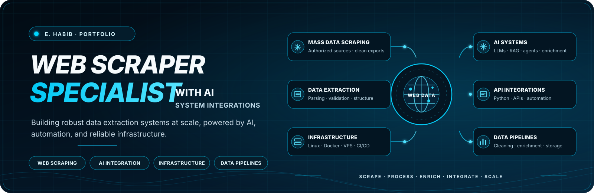
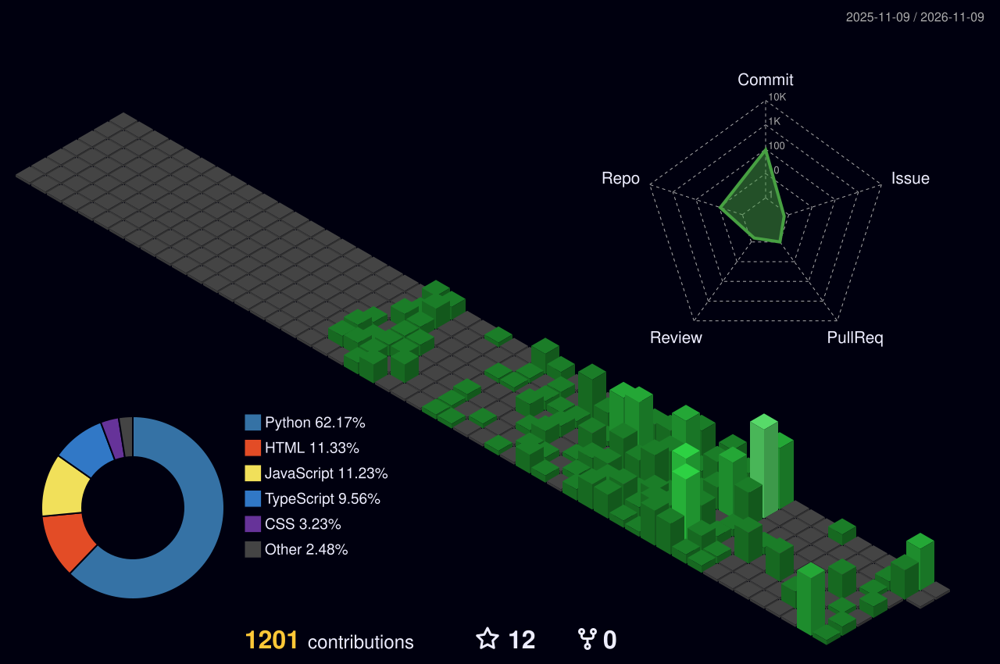

  

# 👋 Hi, I'm E. Habib

## 🕸️ Web Scraper Specialist

**Web Scraping · Mass Data Scraping · AI System Integrations · Python · FastAPI · Data Pipelines**

I build large-scale web crawling and data extraction systems that turn authorized public and business data into structured, useful datasets. I also build AI systems that enrich, classify, search, and automate workflows around that data.

## 👨‍💻 About Me

- 🔭 Building web crawling and data platforms alongside AI-powered automation.
- 🕸️ Focused on scraping from authorized sources, structured extraction, and AI system integrations.
- 🐍 Building data collection services and backend APIs mainly with Python and FastAPI.
- 🌐 Comfortable working across backend, databases, frontend, workers, and Docker.
- 🚀 Interested in turning web data and AI into dependable products and useful automation.

## 🚀 What I Build

- 🕸️ **Web Scraping & Crawling** — authorized collection from public and approved sources, structured extraction, and reliable delivery.
- 📦 **Mass Data Scraping** — scale-aware collection, cleaning, normalization, and export pipelines for research and product intelligence.

- 🤖 **AI Agents** — assistants that use tools, APIs, databases, and business workflows.
- 🔎 **RAG Applications** — AI assistants grounded in documents, private knowledge, and search.
- 🎙️ **Voice AI** — voice applications combining speech-to-text, LLMs, tools, and text-to-speech.
- ⚙️ **AI Automation** — workflows for content, research, data processing, and business operations.
- 🌐 **AI SaaS Products** — full-stack products combining AI features, backend services, databases, and deployment.

## 🧰 Tech Toolbox

### AI & Automation

     

### Web Crawling & Data

    

### Languages & Frameworks

      
  

### Data & Infrastructure

     

## 🔥 Featured Projects

### 📺 TeleMedia — AI Social Media Automation SaaS

**Tech:** AI automation · Python · APIs · TTS · media workflows · Docker

AI-powered content automation platform for media creation and publishing. It combines AI-assisted content generation with voice and media processing, scheduling, platform APIs, backend services, databases, and containerized infrastructure.

The public repository contains the project showcase; the active application is maintained privately.

[🔗 View TeleMedia AI](https://github.com/bvbvbv54/TeleMedia-AI)

### 🔎 Aurora — AI-Powered Research Automation

**Tech:** Web scraping · Python · browser automation · AI classification · SQLite · Docker

Research data-collection platform that crawls YouTube search results, structures and scores the records, then applies AI-assisted classification to identify content opportunities. It includes resumable browser-automation workers, SQLite persistence, reporting, and failure recovery.

[🔗 View Aurora](https://github.com/bvbvbv54/Aurora)

### 🛒 MarketForge AI — AI Commerce Intelligence Platform

**Tech:** Web scraping · Python · FastAPI · Next.js · PostgreSQL · Redis · Docker

Commerce-intelligence platform that combines product and marketplace data collection with AI-assisted opportunity analysis. It turns collected product signals into structured research, product content, visual plans, and marketplace-ready exports, supported by backend APIs, background processing, and a web dashboard.

[🔗 View MarketForge AI](https://github.com/bvbvbv54/MarketForge-AI)

## 🎓 Certifications & Security

  

- **Google AI Fundamentals** — completed through Coursera.
- **System Administration and IT Infrastructure Services** — completed through Google/Coursera, covering server, network, operating-system, and cloud administration.
- **Ethical Hacker** — Cisco Networking Academy certificate, with a verified Credly badge.
- **Next:** preparing for the **Red Hat Certified System Administrator (RHCSA)** exam.

I am building toward a career where **security, system administration, and AI work together**. In an authorized internal security assessment for MAD, I helped identify and address a sensitive document-access weakness; the detailed findings remain confidential.

## 🌐 Let's Connect

   

 

Open to web scraping, data collection, AI system integrations, APIs, and backend automation projects.

## Engineering Activity

  

The skyline is generated from GitHub contribution data by a scheduled workflow in this repository. It refreshes daily and can also be regenerated on demand. The native GitHub contribution calendar remains untouched.

